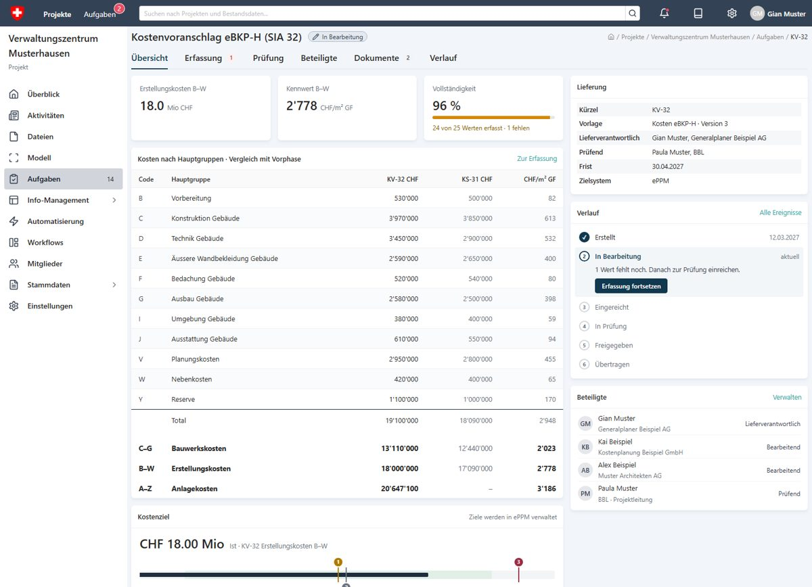
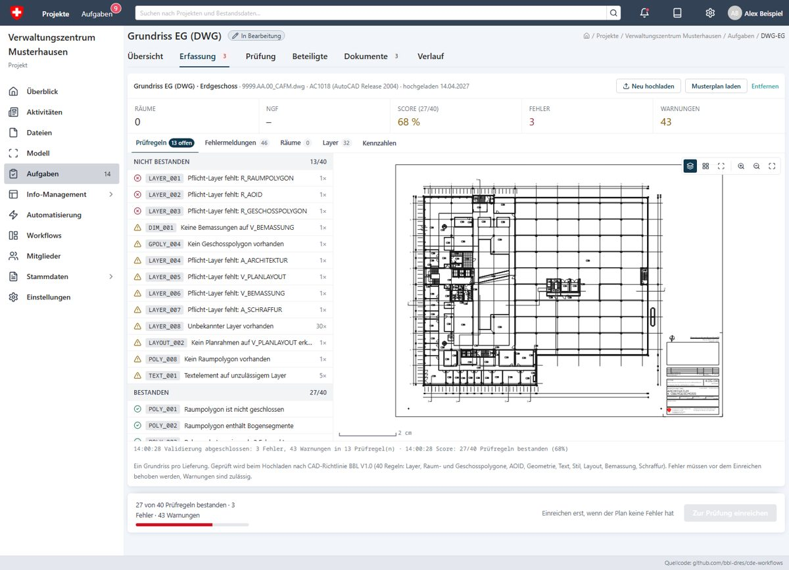

# CDE Bund · Datenlieferungen

[](https://bbl-dres.github.io/cde-workflows/)
[](LICENSE)

> [!CAUTION]
> Unofficial prototype for demonstration only. People, companies, projects and values are fictional or taken from public sources; nothing is connected to the productive CDE Bund.

A clickable prototype of structured data deliveries (Datenformulare) in the CDE Bund, the common data environment of the Swiss Federal Office for Buildings and Logistics (BBL): cost estimate KV-32 (eBKP-H), life-cycle emissions THG-32 and DWG floor plans for the CAFM, each with the same six tabs (Übersicht · Erfassung · Prüfung · Beteiligte · Dokumente · Verlauf) inside a mock of the real application.

## Demo

**Live demo:** https://bbl-dres.github.io/cde-workflows/

<p align="center">
  
  
</p>

Sign in as one of seven sample personas (name at the top right) to follow a delivery from the ordering project manager to the supplier and the reviewer.

## Features

- Order a data delivery in the Informationslieferplan with a template (Kosten eBKP-H, Ökobilanz Bauemissionen nach SIA 2032) and the rule «mandatory from CHF 1 Mio».
- Enter costs per eBKP-H Hauptgruppe or per Kostenelement (open the group, add or remove positions), import an Excel file, see completeness and missing values live.
- Enter the Ökobilanz as emission sources per eBKP-H element group (KBOB dataset, quantity, production and disposal, amortisation after SIA 2032) with the Grundlagen of the calculation; the Endwert for SUS is derived, a Tool-Export import brings the sources in. All eight projects carry complete, plausible mock data (KV-32, KS-31, THG-32) in different workflow states.
- Upload DWG floor plans (one delivery per floor) and check them locally in the browser against the 40 rules of the CAD-Richtlinie BBL, with plan viewer, rooms, floor-area polygons, layers, SIA 416 figures and a downloadable Prüfbericht (PDF).
- Submit, review (automatic checks, checklist, approve or reject) and hand over to ePPM, SUS or the CAFM; statuses flow into the Informationslieferplan, tasks and notifications.
- Übersicht per delivery with KPIs, comparison with the previous phase, Kostenziel or Zielwert chart, workflow steps and participants; project overview with photo and location map.
- Application shell of the CDE Bund: start page with map, projects, tasks with configurable columns, project pages (Aktivitäten, Dokumente, LOIN, Mitglieder, Einstellungen), responsive below 1024 px.

## Run locally

```bash
python -m http.server 8080
```

Open <http://localhost:8080/>. The mock data is loaded with `fetch()`, so the app does not work from `file://`.

## Documentation

- [Bedienung, Routen, Struktur und Tests (DE)](docs/entwicklung.md)
- [Datenformular-Design vom 04.11.2026: Umsetzung (DE)](docs/reviews/2026-11-04-datenformular-design.md)
- [Planlieferungen DWG für das CAFM (DE)](docs/reviews/2026-11-03-planlieferungen-dwg.md)
- [Code-Review Datenformulare, Zustand, Oberfläche (DE)](docs/reviews/2026-11-04-code-review-datenformulare.md)
- [Design-Review, Gap-Analyse und frühere Reviews (DE)](docs/reviews/)
- [Research: THG-Reporting und Ökobilanz Bauemissionen (DE)](docs/research/)

## Data and map sources

Project names follow the public [Bautendokumentationen des BBL](https://www.bbl.admin.ch/de/bautendokumentationen); phases, values, firms and people are fictional. The cost structure uses the eBKP-H element groups (CRB, SN 506 511:2020), the Ökobilanz the KBOB/ecobau-Liste 2022, Version 9.0 ([kbob.admin.ch](https://www.kbob.admin.ch/de/oekobilanzdaten-im-baubereich)) with the amortisation periods of SIA 2032; sources and derivations are in [docs/research/](docs/research/). Maps: CARTO «Positron» vector tiles (worldwide, fallback Esri World Light Gray raster tiles) through MapLibre GL; photos with their licences in [assets/projects/ATTRIBUTION.md](assets/projects/ATTRIBUTION.md).

## License

[MIT License](LICENSE). The plan checker in [js/plancheck/](js/plancheck/) comes from [plan-check](https://github.com/bbl-dres/plan-check) (MIT); the bundled LibreDWG runtime in [js/vendor/libredwg-web/](js/vendor/libredwg-web/) is licensed under GPL-3.0, see [THIRD_PARTY.md](js/plancheck/THIRD_PARTY.md). The Prüfbericht uses jsPDF and jspdf-autotable (MIT, loaded from jsDelivr). Icons by Lucide (ISC).
